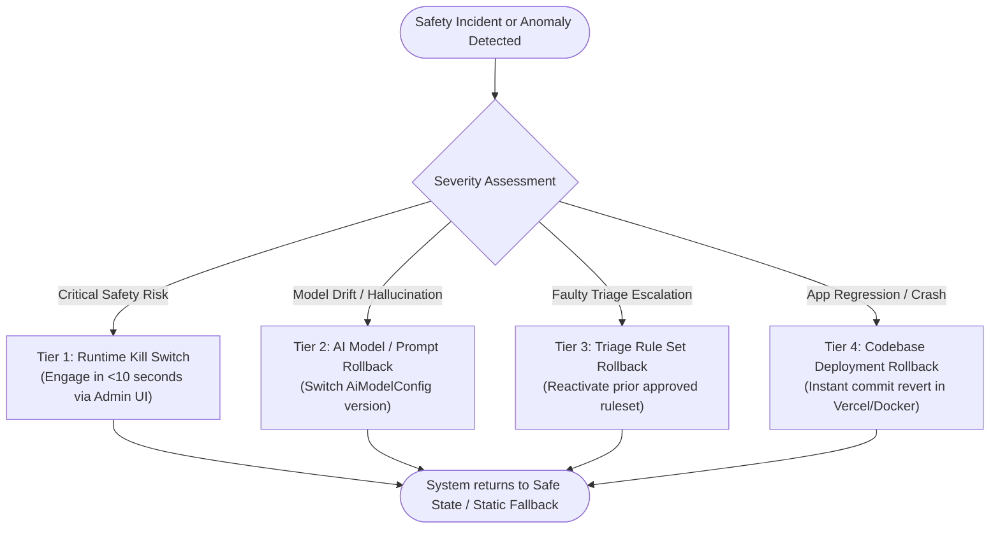

# Clinix Phased Rollout Plan & Rollback Operating Procedures

## 1. Phased Rollout Strategy

Per **Section 18 (Deployment and Production Readiness)**, deployment follows an incremental 4-stage progression gated by clinical metrics and incident monitoring.

```
+-----------------------------------------------------------------------------------+
| Stage 0: Automated Safety & Synthetic Verification (CI/CD Pipeline)              |
| - 100% golden-case evaluation runner pass rate                                   |
| - 100% emergency rule mutation test pass rate                                    |
| - Zero high/critical dependency vulnerabilities; clean secret scan                |
+----------------------------------------+------------------------------------------+
                                         | PASS
                                         v
+-----------------------------------------------------------------------------------+
| Stage 1: Internal Clinician Pilot (Closed Clinical Trial)                         |
| - Cohort: 5-10 licensed Ghanaian clinicians                                       |
| - Workload: Simulated ambiguous, pediatric, obstetric, and trauma scenarios      |
| - Gate: Clinician consensus sign-off; zero missed emergencies                     |
+----------------------------------------+------------------------------------------+
                                         | PASS
                                         v
+-----------------------------------------------------------------------------------+
| Stage 2: Canary Deployment (5% Traffic Cohort)                                   |
| - Target: Greater Accra region                                                    |
| - Duration: 72-hour continuous monitoring burn-in                                 |
| - Gate: SLA metrics stable, error rate < 0.5%, zero safety incidents             |
+----------------------------------------+------------------------------------------+
                                         | PASS
                                         v
+-----------------------------------------------------------------------------------+
| Stage 3: Phased National Expansion                                                |
| - 25% -> 50% -> 100% traffic across all Ghanaian regions                          |
| - Gated at each step by weekly clinical audit and incident review                 |
+-----------------------------------------------------------------------------------+
```

---

## 2. Release Gates & SLA Thresholds

Every promotion to the next stage requires meeting the following non-negotiable gates:

| Metric | Target SLA | Abort / Rollback Threshold |
|---|---|---|
| **Emergency Case False-Negatives** | **0.0%** (Strict Zero Tolerance) | **> 0 incidents** (Immediate emergency rollback) |
| **Emergency Dialer Availability** | **100.0%** (Sub-500ms fallback) | **< 99.99%** |
| **AI Assessment Failure Rate** | **< 0.5%** of requests | **> 1.0%** |
| **P95 Assessment Latency** | **< 4.0 seconds** | **> 8.0 seconds** |
| **Rate Limit / Abuse Spikes** | Nominal | **> 50 rejected requests/minute** |
| **Uncaught Server Exceptions** | **< 0.1%** | **> 0.5%** |

---

## 3. Multi-Tier Rollback Operating Procedures

Clinix implements four distinct, decoupled rollback tiers so that an issue in one layer does not require rolling back the entire platform.



### Tier 1: Instant Runtime Kill Switch (< 10 seconds)
- **When to invoke:** Clinical reviewer or system administrator detects an unsafe model hallucination, zero-day prompt injection, or sudden spike in inaccurate triage output.
- **Action:**
  - Access `/admin/feature-flags` with MFA.
  - Toggle `ai_assessment_enabled` or `medication_info_enabled` to `OFF`.
  - Or trigger authenticated CLI/API request:
    ```bash
    curl -X PATCH https://clinix.org/api/admin/feature-flags/ai_assessment_enabled \
      -H "Authorization: Bearer $ADMIN_TOKEN" \
      -H "Content-Type: application/json" \
      -d '{"enabled": false}'
    ```
- **Result:** `/api/ai/assess` immediately halts NVIDIA calls and returns HTTP 503 `FEATURE_DISABLED` with safe emergency guidance and static helpline directions.

### Tier 2: AI Model / Prompt Version Rollback (< 2 minutes)
- **When to invoke:** NVIDIA model update causes subtle regressions in clinical reasoning or language formatting, but core application code is intact.
- **Action:**
  - Navigate to `/admin/ai-governance`.
  - Select the previously approved model config (e.g., revert from `meta/llama-3.1-70b-instruct` revision 2 to revision 1).
  - Click **Activate Configuration**.
- **Result:** Next.js server immediately begins routing inference requests to the previous model/prompt version without redeployment or container restart.

### Tier 3: Triage Rule Set Rollback (< 2 minutes)
- **When to invoke:** An updated rule set produces false positives or unintended routing.
- **Action:**
  - Navigate to `/admin/rules`.
  - Select the prior reviewed and verified rule set version.
  - Clinical reviewer clicks **Activate Rule Set**.
- **Result:** Triage engine immediately swaps in-memory active rule pointers back to the previous catalog.

### Tier 4: Codebase Deployment Rollback (< 3 minutes)
- **When to invoke:** Application crash, memory leak, or breaking frontend regression.
- **Action:**
  - In Vercel dashboard: Navigate to **Deployments** → Select previous green deployment commit → Click **Instant Rollback**.
  - Or via Vercel CLI:
    ```bash
    vercel rollback <deployment-url-or-id>
    ```
- **Result:** Edge routing points 100% of incoming traffic to the previous immutable release bundle in seconds.

---

## 4. Disaster Recovery & Emergency Decoupling Guarantee

Per **Risk R15 (Provider outage during emergency)**:
- The emergency dialer (`tel:112`), static emergency landing page (`/emergency`), and offline emergency configuration service are completely decoupled from:
  1. NVIDIA Inference APIs
  2. MongoDB Atlas Database
  3. External Map Providers
- If MongoDB, NVIDIA, and Google Maps are simultaneously offline, the application still loads the bundled fallback configuration (`src/data/emergency-configurations.json`) and connects patients to the Ghana National Ambulance Service in under 500 milliseconds.
